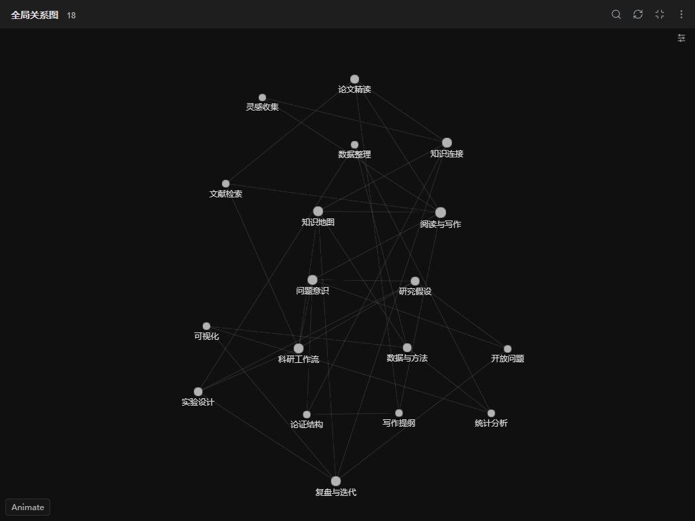
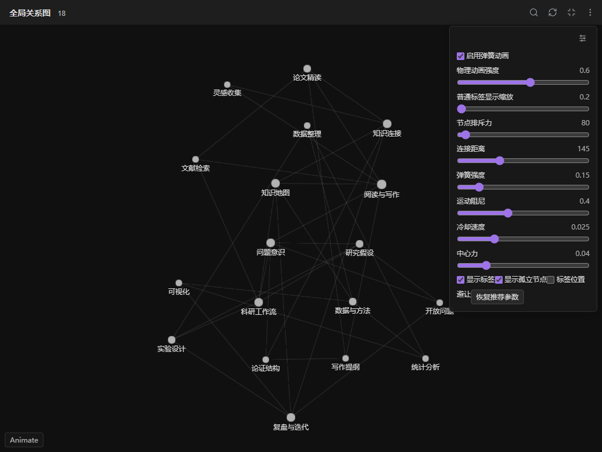
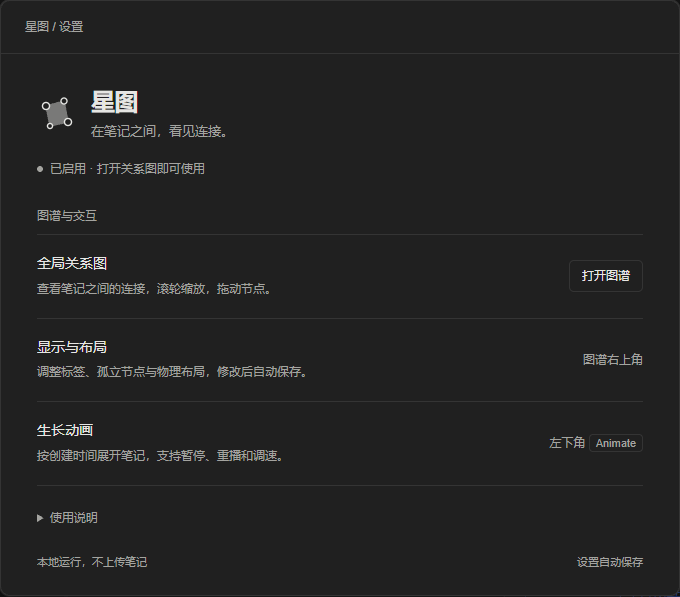

# 星图

让思源原生关系图更清晰、自然。深色背景、灰色节点与紫色焦点，完整标题、平滑缩放、悬停渐变，以及可调节的物理布局。无需 AI API，离线运行。



截图来自思源 3.8.7 的独立演示工作区，使用合成笔记及真实引用关系，不包含私人笔记。

## 使用

启用插件后，继续使用思源原有的全局关系图和局部关系图入口。图谱右上角的调节按钮提供弹簧动画、排斥力、连接距离、阻尼、冷却、标签显示、孤立节点等设置，参数自动保存。滚轮以鼠标位置为中心缩放，拖动节点可牵引相邻节点。

点击图谱左下角 **Animate** 播放生长动画，支持暂停、重播、速度、日期和时间轴。动画根据文档创建时间与**当前引用关系**重建，并非真实的历史快照。

### 图谱参数

展开图谱右上角的调节按钮，可以直接调整动画强度、排斥力、连接距离、阻尼和冷却速度，也可开关标签与孤立节点。「恢复推荐参数」可恢复布局默认值。



### 插件设置

从思源插件管理打开星图设置，可查看接入状态，并打开或收起全局图谱。设置页参考 Notion 的简洁风格，采用通栏分组和细分隔线，支持深浅配色与窄窗口；使用说明可折叠。详细参数位于图谱自己的右上角面板。



## 安装

在「设置 → 集市 → 插件」搜索“星图”安装或更新。

手动安装可从本仓库 Releases 下载 `package.zip`，将包内文件直接解压到工作区 `data/plugins/siyuan-xingtu/`，然后启用插件。最低思源版本为 3.8.7。免费使用，不含广告或付费功能。

## 从个人代码片段迁移

首次启用会读取当前界面的 `og-physics-v1` 参数，保存到星图自己的设置文件，后续以插件设置为准。旧参数保留，方便回退。旧的“Obsidian 样式 · 原生关系图与生长动画”片段必须停用，避免两个实现同时接管图谱。

停用星图会释放插件的线程、观察器、事件和样式，并恢复原生图谱方法。它不改写笔记正文或引用关系。完整标题与创建时间通过思源本地只读查询获取，不上传笔记，不使用遥测。

## 兼容与限制

当前针对思源 3.8.7 的桌面、桌面独立窗口及桌面浏览器界面验证，暂不支持移动端。插件调用原生图谱内部接口，思源升级后需要重新验证；接口不匹配时保留原生图谱并提示。

完整标题在主动缩小至全览时仍可能重叠；不会通过隐藏大批标签或每帧自动缩放相机改变已有阅读体验。性能与验证范围见 [测试说明](docs/TESTING.md)。

0.1.3 起完整标题在首帧之后异步补全，初始布局只占用约 40 毫秒的工作线程时间；空图与标题查询失败时会恢复画布。若思源原生图谱本身没有发起数据请求，此优化无法使其显示节点。

## 构建

```sh
npm ci
npm run build
npm test
npm run check
```

把 `dist/` 内文件直接放入安装包根目录，安装目录名为 `siyuan-xingtu`。

## 来源

作者：yueyangcode。星图来自已在个人工作区使用的图谱增强代码，受 Obsidian 图谱视觉启发，不包含 Obsidian 官方源码，也不打包思源原生引擎。与 Obsidian、思源官方没有隶属关系。

插件代码采用 MIT；力导向布局依赖 D3 的 ISC 许可模块，原始许可见 `licenses/`。首次迁移的源码校验记录见 `docs/PROVENANCE.json`。
